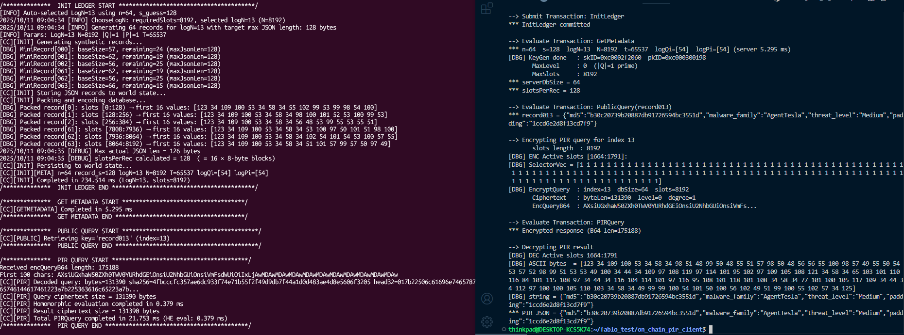

# Bringing Private Reads to Hyperledger Fabric via Private Information Retrieval
Permissioned blockchains ensure integrity and auditability of shared data but expose query parameters 
to peers during read operations, creating privacy risks for organizations querying sensitive records. 
This paper proposes a Private Information Retrieval (PIR) mechanism to enable private reads from Hyperledger 
Fabric’s world state, allowing endorsing peers to process encrypted queries without learning which record 
is accessed. We implement and benchmark a PIR-enabled chaincode that performs ciphertext–plaintext (ct×pt) 
homomorphic multiplication directly within evaluate transactions, preserving Fabric’s endorsement and audit 
semantics. The prototype achieves an average end-to-end latency of 113 ms and a peer-side execution time 
below 42 ms, with approximately 2 MB of peer network traffic per private read in development mode—reducible 
by half under in-process deployment. Storage profiling across three channel configurations shows near-linear 
growth: block size increases from 77 kilobytes to 294 kilobytes and world-state from 112 kilobytes to 332 
kilobytes as the ring dimension scales from 8,192 to 32,768 coefficients. Parameter analysis further 
indicates that ring size and record length jointly constrain packing capacity, supporting up to 512 records 
of 64 bytes each under the largest configuration. These results confirm the practicality of PIR-based 
private reads in Fabric for smaller, sensitive datasets and highlight future directions to optimize 
performance and scalability. 

## Paper

The paper is available as an [arXiv preprint](https://arxiv.org/abs/2511.02656).

## Repository Structure

```text
code_branch_2/
  off_chain_code/    # Off-chain PIR clients, server and evaluation scripts
  on_chain_code/     # Fabric chaincode, clients and benchmarks
figures/            # Protocol illustration
```

This repository contains the implementation and evaluation scripts. Manuscript
working drafts and internal development notes are not part of this release.

## Setup
### Requirements
- **Go ≥ 1.21**
- **Python ≥ 3.10**
- **Hyperledger Fabric v2.5.x** (tested on Fabric network using Docker Compose)
- Optional: `docker`, `docker-compose`, `jq`, `make`

### Usage
Instructions on how to run offchain & onchain variants, benchmark and reproduce plots are provided inside:
```code_branch_2/off_chain_code``` and ```code_branch_2/on_chain_code```

## Result Overview
<p align="center">
  
</p>

## Citation
```
@misc{iasenovets2025bringingprivatereadshyperledger,
  title={Bringing Private Reads to Hyperledger Fabric via Private Information Retrieval},
  author={Artur Iasenovets and Fei Tang and Huihui Zhu and Ping Wang and Lei Liu},
  year={2025},
  eprint={2511.02656},
  archivePrefix={arXiv},
  primaryClass={cs.CR},
  url={https://arxiv.org/abs/2511.02656}
}
```